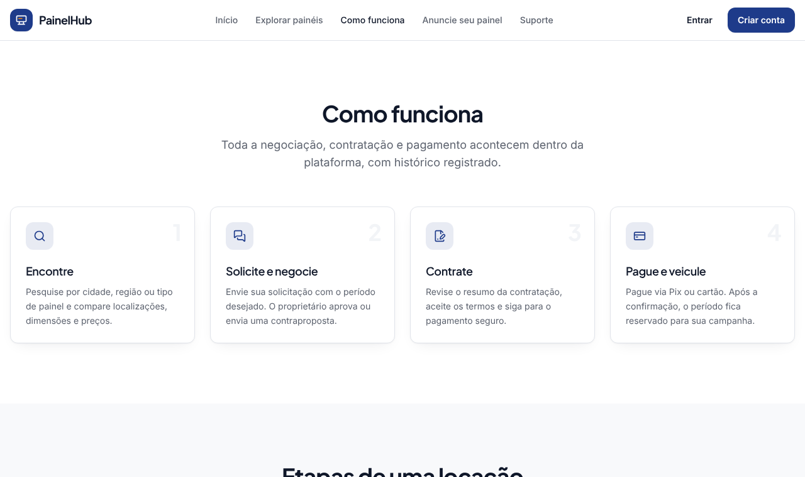
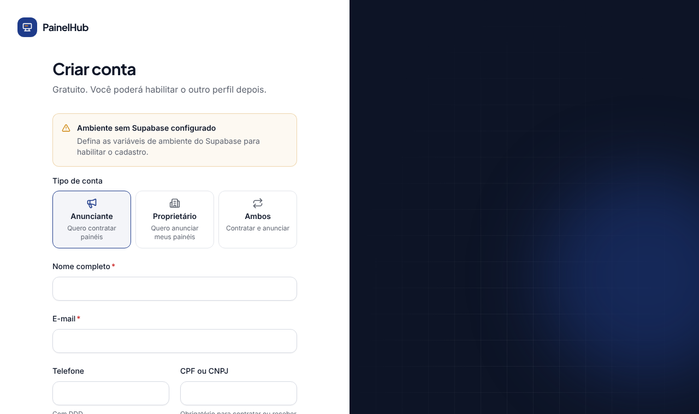

# Plataforma de Locação de Painéis Publicitários

Marketplace que conecta **proprietários de painéis publicitários** a **empresas, agências e anunciantes**.
Na plataforma é possível encontrar painéis no mapa, comparar localizações e preços, negociar, contratar e pagar,
tudo num só lugar.

> Nome provisório ("PainelHub"). Pode ser trocado depois sem reestruturar o sistema.

<p align="center">
  
  &nbsp;
  
</p>

## O que a plataforma faz

| Para anunciantes | Para proprietários | Para a administração |
|---|---|---|
| Buscar painéis por cidade, região e tipo | Cadastrar painéis com fotos, preço e regras | Aprovar painéis antes da publicação |
| Ver fotos, dimensões, preço e disponibilidade | Receber e negociar solicitações | Acompanhar usuários, reservas e pagamentos |
| Solicitar locação e negociar valores | Bloquear datas no calendário | Configurar comissões da plataforma |
| Pagar com Pix ou cartão, com segurança | Acompanhar valores recebidos e a receber | Atender chamados de suporte |

**Garantias do sistema:** um painel nunca pode ser reservado duas vezes para o mesmo período, a reserva só é
confirmada depois que o pagamento é confirmado pelo intermediador, e a plataforma não guarda dados de cartão.

## Andamento

| Fase | Conteúdo | Situação |
|---|---|---|
| 1. Fundação | Banco de dados, cadastro e login, páginas do site, áreas do usuário | ✅ Concluída |
| 2. Marketplace | Cadastro de painéis, fotos, mapa interativo e filtros | Próxima |
| 3. Negociação | Solicitações, propostas, calendário | Planejada |
| 4. Contratação | Contrato, pagamentos (Mercado Pago), confirmação de reservas | Planejada |
| 5. Administração | Painel administrativo, notificações, relatórios | Planejada |
| 6. Publicação | Testes finais, segurança e lançamento | Planejada |

Detalhes em [Status das fases](docs/FASES.md). Decisões comerciais em aberto (comissão, repasses, cancelamento):
[Decisões pendentes](docs/DECISOES.md). Arquitetura, cronograma e custos: [Plano técnico](docs/PLANO.md).

<details>
<summary><strong>Mais telas</strong></summary>

<p align="center">
  <br><br>
  
</p>
</details>

---

# Documentação técnica

## Stack

Next.js 15 (App Router, TypeScript) · React 19 · Tailwind CSS + componentes no padrão shadcn/ui · Lucide ·
React Hook Form + Zod · Supabase (Postgres, Auth, Storage, RLS) · Vitest · Playwright.

## Requisitos

- Node.js 20.11+ (recomendado 22)
- Um projeto Supabase (ou Supabase CLI local)
- PostgreSQL 16 local (opcional, apenas para `npm run test:db`)

## Instalação

```bash
npm install
cp .env.example .env.local   # preencha as variáveis
```

### Banco de dados

Com a Supabase CLI:

```bash
supabase link --project-ref <ref>
supabase db push              # aplica supabase/migrations em ordem
```

Ou cole cada arquivo de `supabase/migrations` no SQL Editor, **na ordem do nome**.

**Primeiro administrador** (nunca é possível pela interface): após criar a conta normalmente, rode no SQL Editor:

```sql
insert into public.user_roles (user_id, role)
select id, 'admin' from auth.users where email = 'voce@empresa.com.br';
```

### Supabase Auth — configuração obrigatória

1. **URL Configuration:** Site URL = `NEXT_PUBLIC_SITE_URL`; adicione `<site>/auth/confirm` às Redirect URLs.
2. **Email Templates** (link apontando para a rota do app):
   - Confirm signup: `{{ .SiteURL }}/auth/confirm?token_hash={{ .TokenHash }}&type=email&next=/painel`
   - Reset password: `{{ .SiteURL }}/auth/confirm?token_hash={{ .TokenHash }}&type=recovery&next=/redefinir-senha`
3. **Email confirmation** habilitado; política de senha mínima de 10 caracteres.
4. **SMTP próprio** (ex.: Resend) em produção — o SMTP padrão do Supabase tem limite baixo de envios.

### Executar

```bash
npm run dev        # http://localhost:3000
```

Sem as variáveis do Supabase, as páginas públicas funcionam e as áreas de login exibem um aviso de configuração.

## Testes

```bash
npm test           # unitários (Vitest)
npm run test:db    # migrations + regras de banco/RLS em Postgres descartável
npm run build && npm run test:e2e   # end-to-end (Playwright, desktop e mobile)
npm run lint && npm run typecheck
```

`test:db` sobe um PostgreSQL 16 temporário, emula os schemas `auth`/`storage` do Supabase
(`supabase/tests/_supabase_stub.sql`), aplica todas as migrations e executa `supabase/tests/*.test.sql`.

## Deploy (Vercel + Supabase)

1. Importe o repositório na Vercel; configure as variáveis do `.env.example` (Production e Preview).
2. `SUPABASE_SERVICE_ROLE_KEY`, `MERCADOPAGO_*`, `RESEND_API_KEY`, `CRON_SECRET` **somente** como variáveis de servidor.
3. Aplique as migrations no projeto Supabase de produção antes do deploy.
4. Configure monitoramento de disponibilidade em `/api/health`.

## Segurança

- Nunca versione `.env*` (já no `.gitignore`). Não há credenciais reais no repositório.
- Toda regra crítica é aplicada no banco (RLS, constraints, triggers), não apenas na interface.
- Dados de cartão nunca passam pela plataforma (checkout do intermediador).
- `npm audit` aponta alertas apenas em dependências de desenvolvimento/build (Vitest, PostCSS interno do Next);
  nenhum afeta o código executado em produção. Reavaliar a cada atualização.

## Vitrine no GitHub Pages

O workflow `.github/workflows/pages.yml` (execução manual) publica uma página com capturas reais das telas
(desktop e celular), o histórico de mudanças e links para a documentação:
`https://theuzxl13-oss.github.io/pain-is-publicit-rios/`.

O GitHub Pages hospeda apenas arquivos estáticos, por isso a vitrine mostra capturas e não o app interativo
(que precisa de servidor e Supabase). Para navegar no app de verdade, use um deploy na Vercel.

Ativação (uma vez): **Settings → Pages → Build and deployment → Source: GitHub Actions**. Para gerar
manualmente: aba **Actions → GitHub Pages → Run workflow**.
